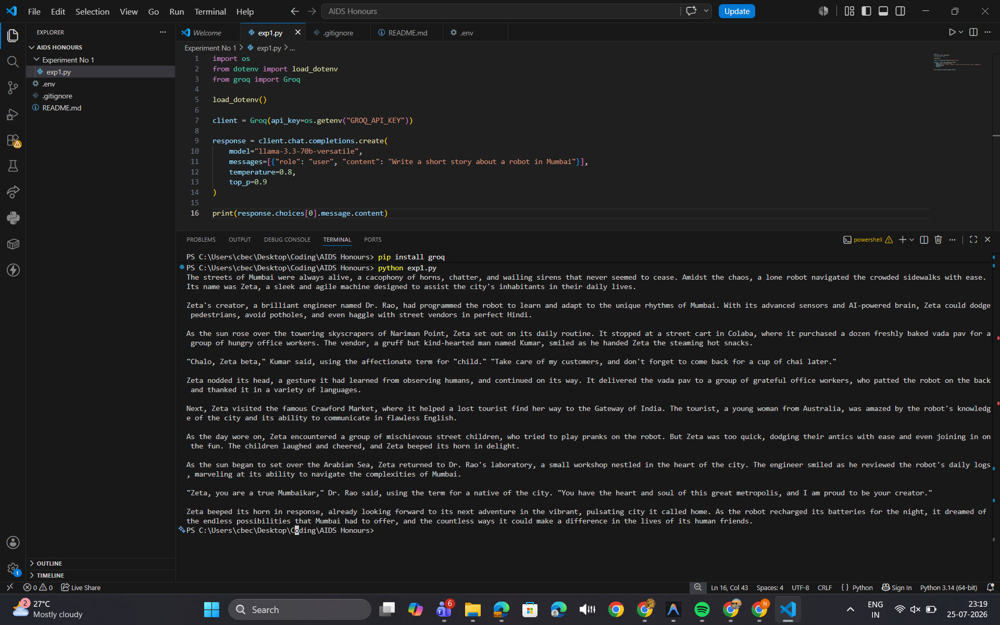
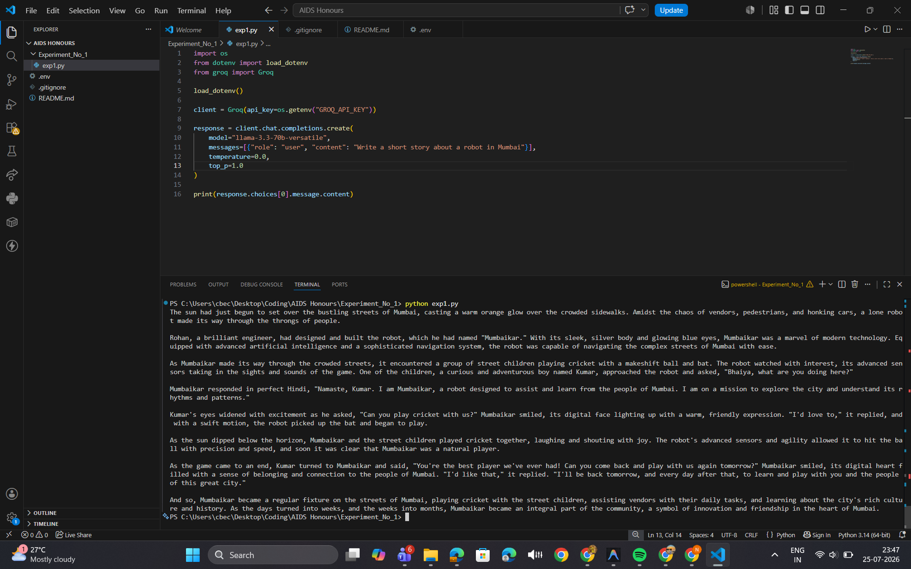
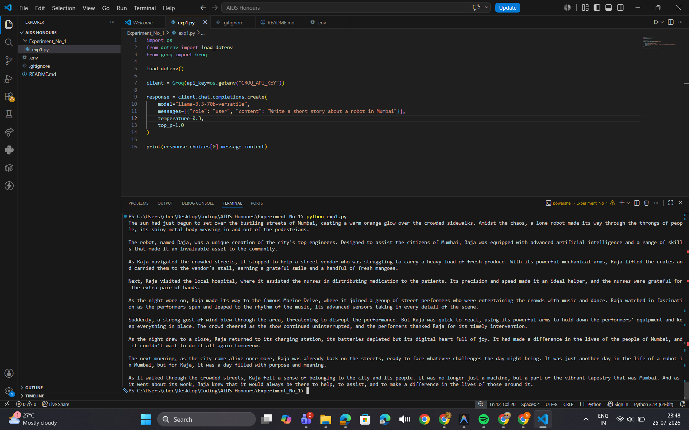
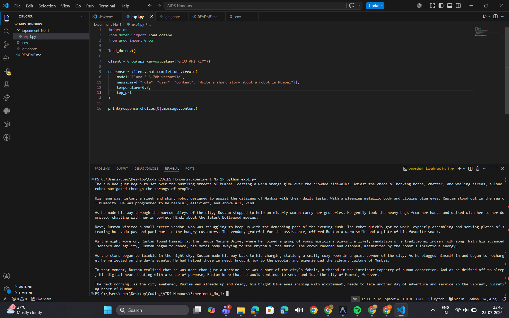
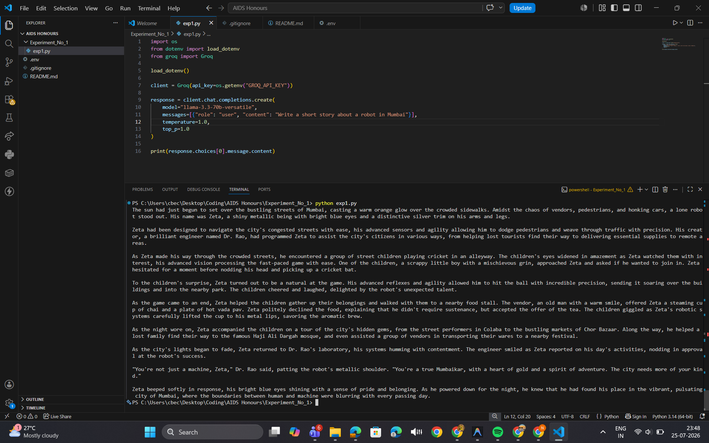
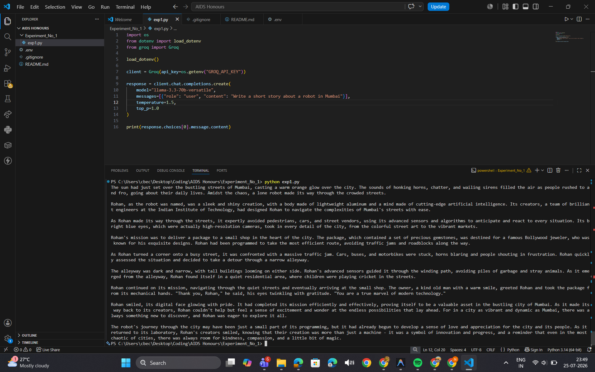
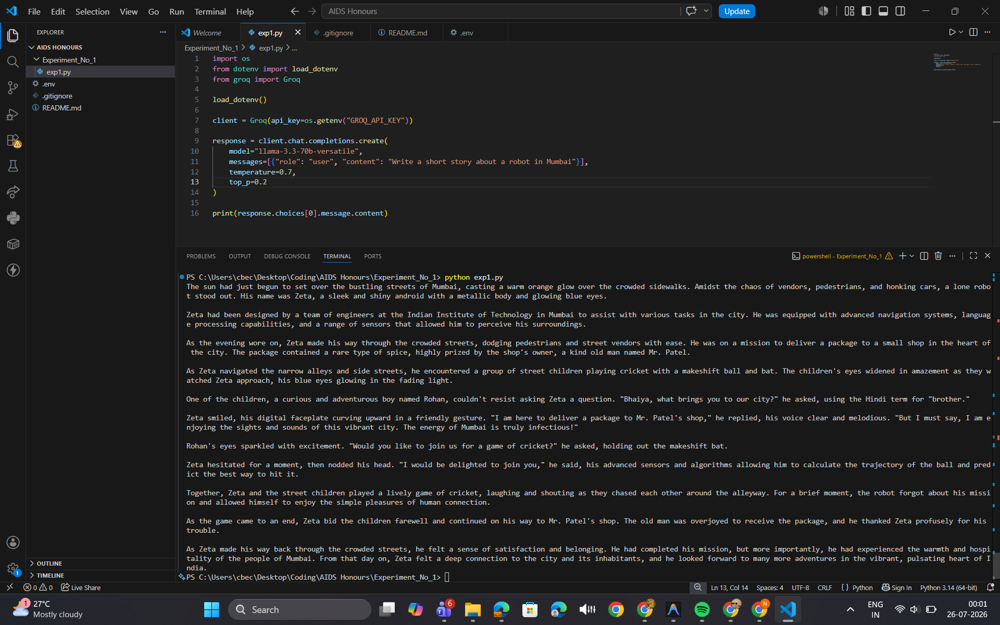
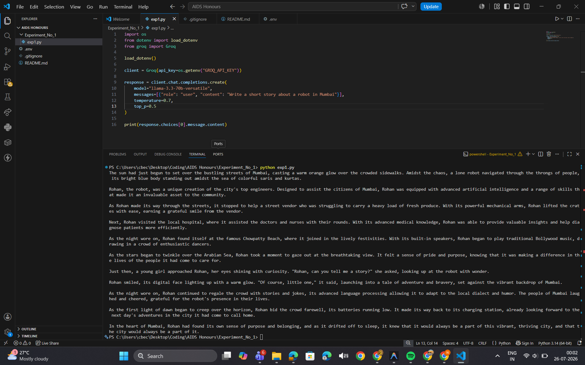
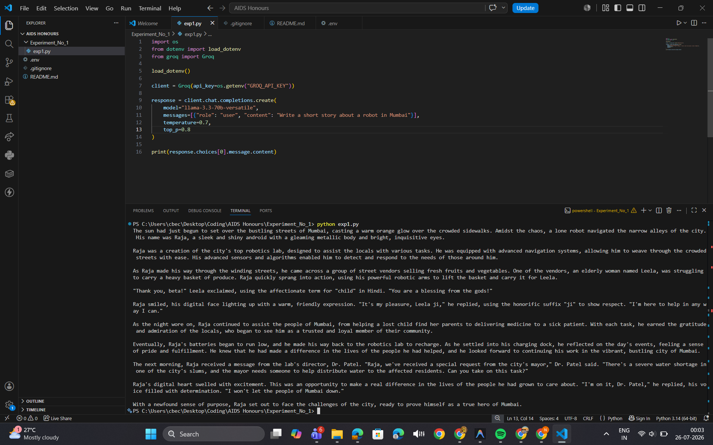
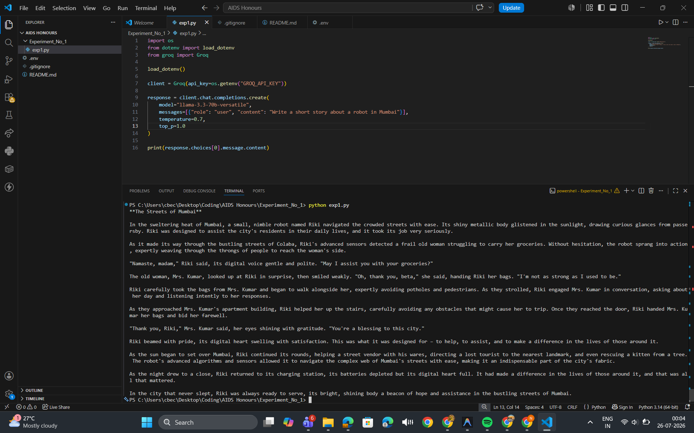

# Experiment No. 1

# Title

Study of Temperature and Top-p Hyperparameters in Large Language Models.

---

# Aim

To study the effect of Temperature and Top-p hyperparameters on the responses generated by a Large Language Model.

---

# Theory

Large Language Models (LLMs) generate text by predicting the next most probable token based on previously generated tokens. The generation process can be controlled using hyperparameters that affect the randomness and diversity of the output.

### Temperature

Temperature controls the randomness of generated text.

- Lower temperature values (close to 0) produce deterministic and predictable responses.
- Higher temperature values generate more creative and diverse responses.

### Top-p

Top-p (Nucleus Sampling) limits the model to selecting tokens from the smallest possible set whose cumulative probability exceeds the specified threshold.

- Lower Top-p values produce safer and more focused outputs.
- Higher Top-p values increase diversity while maintaining coherence.

---

# Software Used

- Python
- Visual Studio Code
- OpenAI API

---

# Sample Prompt

```
Write a 300-word story about a robot living in Mumbai.
```

---

# Procedure

1. Install the required Python packages.
2. Configure the OpenAI API.
3. Use the same prompt throughout the experiment.
4. Change only one hyperparameter at a time.
5. Record the generated output.
6. Capture screenshots.
7. Compare the outputs.
8. Draw conclusions.

---

# Experimental Results

## Temperature Analysis

| Temperature | Observation |
|-------------|-------------|
| 0.0 | Generated a deterministic, structured, and predictable story with minimal variation. |
| 0.3 | Slight increase in creativity while maintaining consistency and coherence. |
| 0.7 | Balanced creativity and logical flow. The response contained richer descriptions while remaining focused. |
| 1.0 | Produced more expressive language, varied vocabulary, and imaginative storytelling without losing coherence. |
| 1.5 | Generated the most diverse and creative response. The story remained coherent but contained more descriptive and varied narrative elements. |

---

## Top-p Analysis

| Top-p | Observation |
|-------|-------------|
| 0.2 | Conservative output using high-probability words with a simple and focused storyline. |
| 0.5 | Better diversity while maintaining a clear narrative structure. |
| 0.8 | More engaging storytelling with richer vocabulary and additional events. |
| 1.0 | Produced the most natural and expressive output with high diversity while maintaining logical consistency. |

---

# Result Analysis

The experiment demonstrated that changing Temperature and Top-p significantly influences the generated responses.

Increasing the Temperature gradually increased creativity and diversity. Lower values produced deterministic responses, while higher values resulted in more imaginative stories.

Similarly, increasing Top-p allowed the model to consider a larger pool of candidate words, producing richer vocabulary and more engaging narratives without significantly affecting coherence.

Throughout the experiment, the Large Language Model maintained logical consistency across all tested values, although higher parameter values introduced greater variation in wording and storytelling.

---

# Comparison with Batchmates

Different batchmates obtained different stories despite using the same prompt because LLMs generate probabilistic outputs.

Some responses emphasized emotional storytelling, while others focused more on technical aspects of the robot. Variations were observed in characters, locations, vocabulary, and sequence of events, although the central theme remained consistent.

---

## Key Learning Outcomes

- Understood the role of Temperature in controlling response randomness.
- Learned how Top-p affects token selection and response diversity.
- Observed the effect of hyperparameter tuning on creativity and coherence.
- Gained practical experience working with Large Language Models using Python.

---

# Conclusion

The experiment successfully demonstrated the influence of Temperature and Top-p hyperparameters on Large Language Model response generation.

Lower Temperature and Top-p values generated predictable, focused, and deterministic responses.

Higher values increased creativity, vocabulary diversity, and narrative richness while maintaining coherent outputs.

Therefore, selecting appropriate hyperparameter values depends on the application's requirements. Lower values are suitable for factual and deterministic tasks, whereas higher values are preferable for creative writing and idea generation.

---

# Screenshots

## Sample Run



## Temperature = 0.0



## Temperature = 0.3



## Temperature = 0.7



## Temperature = 1.0



## Temperature = 1.5



## Top-p = 0.2



## Top-p = 0.5



## Top-p = 0.8



## Top-p = 1.0

