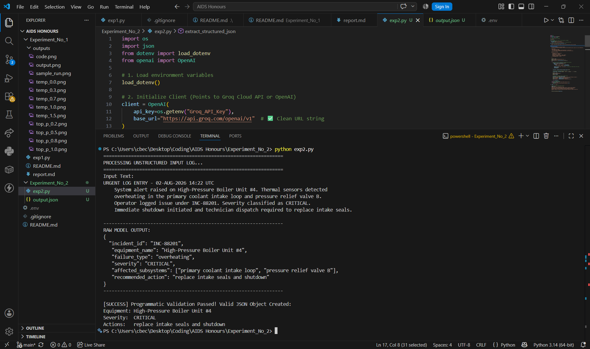

# Experiment No. 2

# Title

Structured JSON Extraction from Unstructured Engineering Logs using Large Language Models

---

# Aim

To construct a system prompt that extracts information from unstructured engineering fault logs into a strict JSON schema and validates the generated JSON using Python.

---

# Theory

Large Language Models (LLMs) can convert unstructured text into structured machine-readable formats when guided by carefully designed system prompts.

In many software engineering applications, logs generated by operators, sensors, or monitoring systems contain valuable information but are not directly usable by databases or automated workflows. Prompt engineering enables an LLM to identify relevant entities and organize them into a predefined JSON schema.

To ensure reliable structured output:

- A detailed **system prompt** specifies the required JSON schema.
- **Temperature = 0.0** minimizes randomness and produces deterministic output.
- **response_format={"type":"json_object"}** forces the model to generate valid JSON.
- Python's built-in **json** module validates the generated response before it can be used by downstream applications.

This approach enables safe integration of LLMs into backend software systems.

---

# Software Used

- Python 3.x
- Visual Studio Code
- Groq API
- OpenAI Python SDK
- python-dotenv
- json module

---

# Sample Input

```text
URGENT LOG ENTRY - 02-AUG-2026 14:22 UTC

System alert raised on High-Pressure Boiler Unit #4.
Thermal sensors detected overheating in the primary coolant intake loop
and pressure relief valve B.

Operator logged issue under INC-88201.
Severity classified as CRITICAL.

Immediate shutdown initiated and technician dispatch required
to replace intake seals.
```

---

# Procedure

1. Install the required Python libraries.
2. Configure the Groq API key using the `.env` file.
3. Initialize the OpenAI-compatible Groq client.
4. Design a system prompt defining the required JSON schema.
5. Pass the unstructured engineering log as the user input.
6. Configure:
   - Temperature = 0.0
   - response_format = {"type":"json_object"}
7. Receive the generated JSON response.
8. Validate the response using Python's `json.loads()` function.
9. Display the extracted structured information.

---

# Experimental Results

## Extracted JSON

```json
{
  "incident_id": "INC-88201",
  "equipment_name": "High-Pressure Boiler Unit #4",
  "failure_type": "overheating",
  "severity": "CRITICAL",
  "affected_subsystems": [
    "primary coolant intake loop",
    "pressure relief valve B"
  ],
  "recommended_action": "replace intake seals and shutdown"
}
```

---

## Observation Table

| Input Type | Extracted Output | Software Application |
|------------|------------------|----------------------|
| Unstructured engineering fault log | Strict JSON object containing incident ID, equipment name, failure type, severity, affected subsystems, and recommended action | Database ingestion, ERP systems, maintenance management, incident reporting, analytics pipelines |

---

# Result Analysis

The experiment successfully demonstrated the capability of a Large Language Model to convert unstructured engineering fault logs into a structured JSON object.

Using a carefully designed system prompt ensured that every required field was extracted according to the predefined schema.

Setting the temperature to **0.0** produced deterministic and consistent responses, eliminating unnecessary creativity.

The `response_format={"type":"json_object"}` parameter ensured that the model returned valid JSON without additional conversational text or Markdown formatting.

Finally, the generated output was successfully validated using Python's `json.loads()` function, confirming that it can be directly integrated into backend software systems and automated workflows.

---

# Comparison with Batchmates

Although all students used the same engineering fault log, slight variations may occur depending on the language model or API provider used. However, because the experiment uses a strict JSON schema, deterministic temperature (0.0), and JSON mode, the extracted fields remain largely consistent across implementations.

---

# Key Learning Outcomes

- Learned how to design system prompts for structured data extraction.
- Understood the importance of schema enforcement in LLM applications.
- Learned how deterministic inference improves output consistency.
- Gained practical experience using JSON mode in modern LLM APIs.
- Learned to validate model-generated JSON programmatically using Python.

---

# Conclusion

The experiment successfully demonstrated structured JSON extraction from unstructured engineering fault logs using a Large Language Model.

By combining prompt engineering, deterministic inference (Temperature = 0.0), API-level JSON mode, and Python-based validation, reliable machine-readable output was obtained.

This approach is highly useful in software engineering applications such as automated incident management, predictive maintenance, enterprise resource planning (ERP), and data analytics, where structured data is essential for downstream processing.

---

# Questions

### 1. Why is schema enforcement critical when integrating LLMs into software engineering pipelines?

Schema enforcement ensures that the generated output follows a predictable machine-readable structure such as JSON. Backend applications, databases, and APIs require consistent data formats, and schema enforcement prevents invalid or inconsistent responses from disrupting automated workflows.

---

### 2. How does setting Temperature = 0.0 assist in structured data extraction tasks?

A temperature value of **0.0** makes the model deterministic by selecting the highest-probability tokens. This minimizes randomness and helps the model adhere strictly to the specified JSON schema.

---

### 3. What is the function of the `response_format={"type":"json_object"}` parameter?

It enables JSON mode, ensuring that the model returns only valid JSON output. This prevents additional conversational text, Markdown formatting, or syntax errors, making the response suitable for direct programmatic processing.

---

# Screenshots

## Program Output

