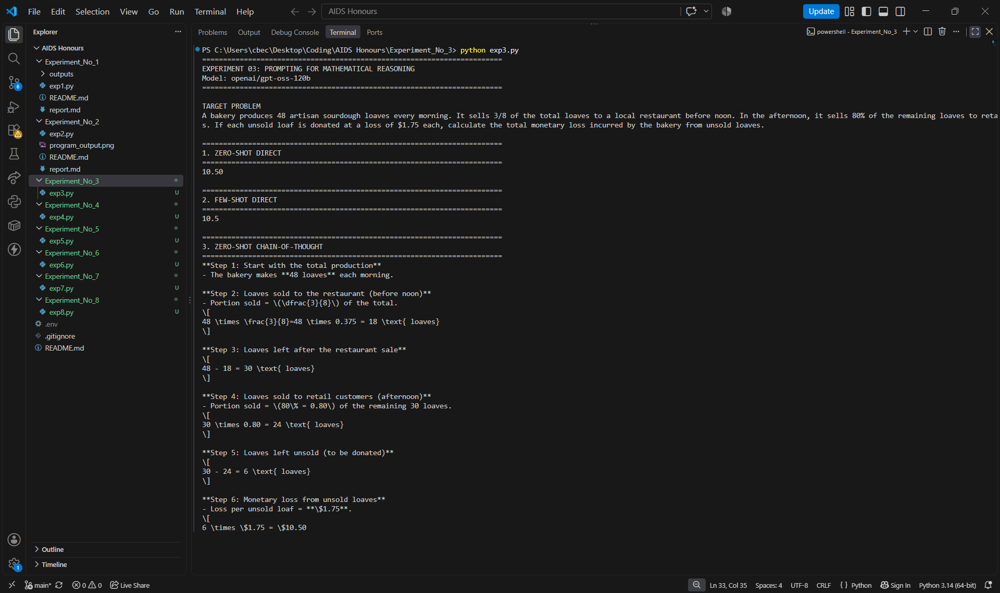
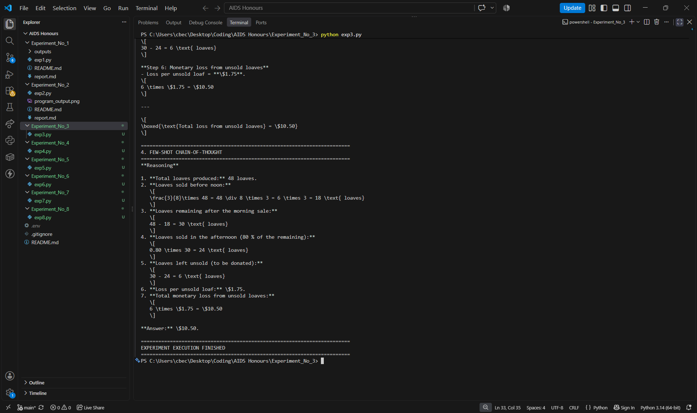

# Experiment No. 3

## Few-Shot and Chain-of-Thought Prompting for Mathematical Reasoning

## Overview

This experiment demonstrates how different Prompt Engineering techniques influence the mathematical reasoning capabilities of Large Language Models (LLMs).

Four prompting techniques are implemented and compared:

1. Zero-Shot Direct Prompting
2. Few-Shot Direct Prompting
3. Zero-Shot Chain-of-Thought Prompting
4. Few-Shot Chain-of-Thought Prompting

The experiment uses the Groq API with an OpenAI-compatible Python SDK to solve a mathematical word problem and compare the generated responses.

## Technologies Used

- Python 3.x
- Visual Studio Code
- Groq API
- OpenAI Python SDK
- python-dotenv

## Project Structure

    Experiment_No_3/
    ├── code.png
    └── output.png
    │
    ├── exp3.py
    ├── report.md
    ├── README.md

## Features

- Implements four different Prompt Engineering techniques.
- Demonstrates Zero-Shot and Few-Shot prompting.
- Demonstrates Direct and Chain-of-Thought prompting.
- Uses Groq API for Large Language Model inference.
- Compares direct answers with step-by-step mathematical explanations.
- Uses the same mathematical problem across all four techniques.
- Demonstrates how prompt design influences LLM responses.

## Mathematical Problem

A bakery produces 48 artisan sourdough loaves every morning. It sells 3/8 of the total loaves to a local restaurant before noon. In the afternoon, it sells 80% of the remaining loaves to retail customers. If each unsold loaf is donated at a loss of $1.75 each, calculate the total monetary loss incurred by the bakery from unsold loaves.

## Prompting Techniques

### 1. Zero-Shot Direct Prompting

The model receives the mathematical problem directly without examples or additional reasoning instructions.

### 2. Few-Shot Direct Prompting

The model receives example question-answer pairs before solving the target problem.

### 3. Zero-Shot Chain-of-Thought Prompting

The model receives the target problem with instructions to explain the calculation step by step.

### 4. Few-Shot Chain-of-Thought Prompting

The model receives example problems with reasoning steps before solving the target problem using a similar approach.

## Expected Mathematical Calculation

- Total loaves produced = 48
- Loaves sold to restaurant = 48 × 3/8 = 18
- Remaining loaves = 48 - 18 = 30
- Loaves sold to retail customers = 30 × 80/100 = 24
- Unsold loaves = 30 - 24 = 6
- Loss per unsold loaf = $1.75
- Total monetary loss = 6 × $1.75 = $10.50

## Expected Output

All four prompting techniques should produce the correct monetary loss of **$10.50**.

The direct prompting techniques provide concise answers, while the Chain-of-Thought techniques provide detailed mathematical explanations.

## How to Run

### 1. Clone the Repository

    git clone <repository-url>

### 2. Navigate to the Experiment Folder

    cd Experiment_No_3

### 3. Create and Activate Virtual Environment (Optional)

For Windows:

    python -m venv venv
    venv\Scripts\activate

### 4. Install Required Packages

    pip install -r requirements.txt

Alternatively:

    pip install openai python-dotenv

### 5. Configure the Groq API Key

Create a `.env` file in the project directory:

    GROQ_API_KEY=YOUR_GROQ_API_KEY

Replace `YOUR_GROQ_API_KEY` with your actual Groq API key.

**Important:** Never upload your `.env` file or expose your API key on GitHub.

### 6. Execute the Program

    python exp3.py

## Model Configuration

- API Provider: Groq
- Model: openai/gpt-oss-120b
- SDK: OpenAI Python SDK
- API Compatibility: OpenAI-compatible Groq endpoint

## Learning Outcomes

- Understand Zero-Shot and Few-Shot Prompting.
- Understand Direct and Chain-of-Thought Prompting.
- Learn how examples influence LLM responses.
- Compare different Prompt Engineering techniques.
- Understand how LLMs approach mathematical word problems.
- Gain practical experience using the Groq API with Python.

## Screenshots

### Program Output

## Author

**Nihar Padave**

B.Tech Electronics and Computer Science  
Shah & Anchor Kutchhi Engineering College  
Artificial Intelligence & Data Science (Honours)  
Academic Year: 2026–27

## License

This project is created for educational and academic purposes as part of the Artificial Intelligence & Data Science (Honours) laboratory coursework.