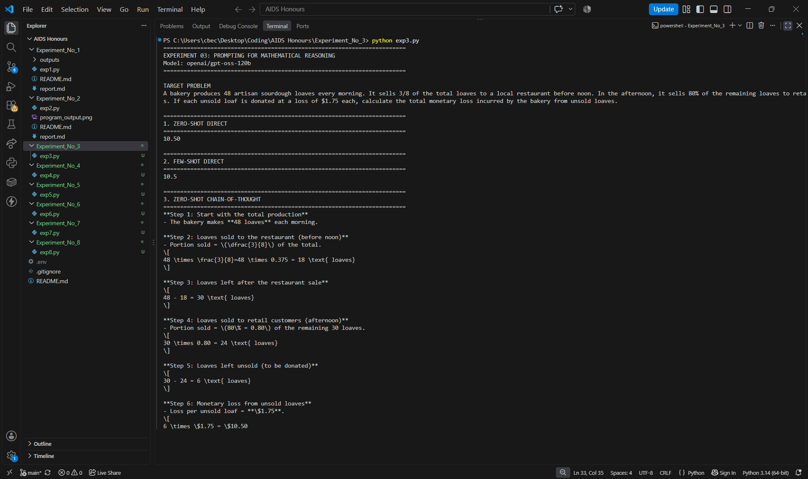
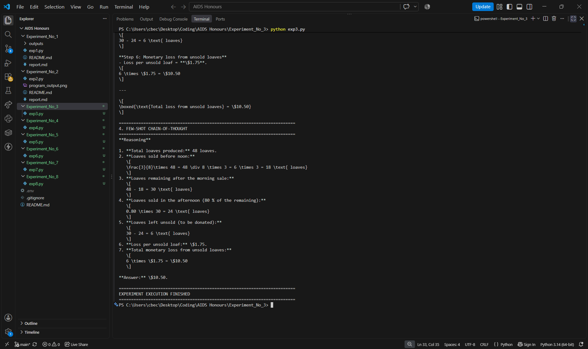

# Experiment No. 3

## Title

**Few-Shot and Chain-of-Thought Prompting for Mathematical Reasoning**

## Aim

To implement and compare Zero-Shot, Few-Shot, Direct, and Chain-of-Thought Prompting techniques using a Large Language Model to solve a mathematical word problem.

## Objective

This experiment demonstrates how different Prompt Engineering techniques influence the mathematical reasoning capabilities of Large Language Models (LLMs).

Four prompting approaches are implemented to compare direct mathematical answers with step-by-step reasoning and to understand the effect of providing examples in prompts.

## Theory

Prompt Engineering is the process of designing and structuring inputs to guide Large Language Models toward producing desired outputs.

Different prompting techniques can influence how an LLM interprets a problem and generates its response.

### 1. Zero-Shot Prompting

Zero-Shot Prompting involves providing the model with a task or question without giving any examples.

The model uses its existing knowledge and capabilities to generate an answer.

### 2. Few-Shot Prompting

Few-Shot Prompting provides the model with a small number of examples before presenting the actual problem.

These examples help the model understand the expected response format and approach.

### 3. Direct Prompting

Direct Prompting asks the model to provide the final answer without requiring a detailed explanation or intermediate reasoning steps.

It is useful when concise answers are required.

### 4. Chain-of-Thought Prompting

Chain-of-Thought Prompting encourages the model to provide a step-by-step explanation of the problem-solving process.

It helps present intermediate calculations and makes the generated solution easier to understand.

### 5. Few-Shot Chain-of-Thought Prompting

This technique combines Few-Shot Prompting and Chain-of-Thought Prompting.

The model receives examples containing both problems and their reasoning steps before solving the target problem using a similar approach.

## Software Used

- Python 3.x
- Visual Studio Code
- Groq API
- OpenAI Python SDK
- python-dotenv

## Mathematical Problem

A bakery produces 48 artisan sourdough loaves every morning. It sells 3/8 of the total loaves to a local restaurant before noon. In the afternoon, it sells 80% of the remaining loaves to retail customers. If each unsold loaf is donated at a loss of $1.75 each, calculate the total monetary loss incurred by the bakery from unsold loaves.

## Procedure

1. Install the required Python libraries.
2. Configure the Groq API key using the `.env` file.
3. Initialize the OpenAI-compatible Groq client.
4. Define the mathematical problem to be solved.
5. Implement Zero-Shot Direct Prompting.
6. Implement Few-Shot Direct Prompting using example question-answer pairs.
7. Implement Zero-Shot Chain-of-Thought Prompting with step-by-step reasoning instructions.
8. Implement Few-Shot Chain-of-Thought Prompting using example problems and their reasoning steps.
9. Send all four prompts to the selected Large Language Model.
10. Display and compare the generated responses.

## Experimental Results

The experiment was executed using the Groq API and the `openai/gpt-oss-120b` model.

### 1. Zero-Shot Direct

**Generated Output:**

    10.50

### 2. Few-Shot Direct

**Generated Output:**

    10.5

### 3. Zero-Shot Chain-of-Thought

**Generated Output:**

The model generated a step-by-step mathematical explanation:

**Step 1: Total production**

    Total loaves = 48

**Step 2: First sale to the restaurant**

    3/8 × 48 = 18 loaves

**Step 3: Remaining loaves**

    48 - 18 = 30 loaves

**Step 4: Afternoon sale**

    80% × 30 = 24 loaves

**Step 5: Unsold loaves**

    30 - 24 = 6 loaves

**Step 6: Calculate monetary loss**

    6 × $1.75 = $10.50

**Final Answer: $10.50**

### 4. Few-Shot Chain-of-Thought

**Generated Output:**

The model generated a detailed explanation using the example-based reasoning approach.

1. Total loaves produced = 48.
2. Loaves sold in the morning = 3/8 × 48 = 18.
3. Remaining loaves = 48 - 18 = 30.
4. Afternoon sales = 80% × 30 = 24.
5. Unsold loaves = 30 - 24 = 6.
6. Loss per unsold loaf = $1.75.
7. Total monetary loss = 6 × 1.75 = $10.50.

**Final Answer: $10.50**

## Observation Table

| Prompting Technique | Generated Response | Observation |
|---|---|---|
| Zero-Shot Direct | $10.50 | Generated a concise answer without examples. |
| Few-Shot Direct | $10.50 | Generated a concise answer after receiving examples. |
| Zero-Shot Chain-of-Thought | $10.50 with step-by-step explanation | Explained the mathematical calculations without examples. |
| Few-Shot Chain-of-Thought | $10.50 with detailed explanation | Used example-based guidance to generate a structured solution. |

## Result Analysis

The experiment successfully demonstrated four different Prompt Engineering techniques for mathematical reasoning using a Large Language Model.

Zero-Shot Direct Prompting generated the final answer without requiring examples or detailed explanations.

Few-Shot Direct Prompting also generated the correct answer after receiving example question-answer pairs.

Zero-Shot Chain-of-Thought Prompting generated a detailed mathematical explanation by breaking the problem into individual calculation steps.

Few-Shot Chain-of-Thought Prompting generated a structured explanation using the example-based approach.

All four techniques successfully calculated the total monetary loss as **$10.50**.

The experiment demonstrates that different prompting techniques can influence the structure, detail, and presentation of LLM-generated responses.

## Comparison of Prompting Techniques

| Technique | Examples Provided | Step-by-Step Explanation | Main Purpose |
|---|---|---|---|
| Zero-Shot Direct | No | No | Obtain a direct answer. |
| Few-Shot Direct | Yes | No | Guide the model using examples. |
| Zero-Shot Chain-of-Thought | No | Yes | Encourage step-by-step problem solving. |
| Few-Shot Chain-of-Thought | Yes | Yes | Combine examples with step-by-step explanations. |

## Key Learning Outcomes

- Learned the difference between Zero-Shot and Few-Shot Prompting.
- Understood Direct and Chain-of-Thought Prompting techniques.
- Learned how examples influence LLM-generated responses.
- Compared different prompting approaches for mathematical reasoning.
- Understood how prompt design affects response structure and detail.
- Gained practical experience using the Groq API with Python.

## Conclusion

The experiment successfully demonstrated the implementation and comparison of four Prompt Engineering techniques: Zero-Shot Direct, Few-Shot Direct, Zero-Shot Chain-of-Thought, and Few-Shot Chain-of-Thought Prompting.

All four techniques successfully solved the given bakery problem and calculated the total monetary loss as **$10.50**.

The experiment showed that Direct Prompting produces concise answers, whereas Chain-of-Thought Prompting produces detailed mathematical explanations. Few-Shot Prompting further demonstrates how examples can guide the model's response format and approach.

Thus, Prompt Engineering plays an important role in controlling the structure and detail of responses generated by Large Language Models.

## Screenshots

### Program Output

## Author Details

**Nihar Padave**

B.Tech Electronics and Computer Science  
Shah & Anchor Kutchhi Engineering College  
Artificial Intelligence & Data Science (Honours)  
Academic Year: 2026–27